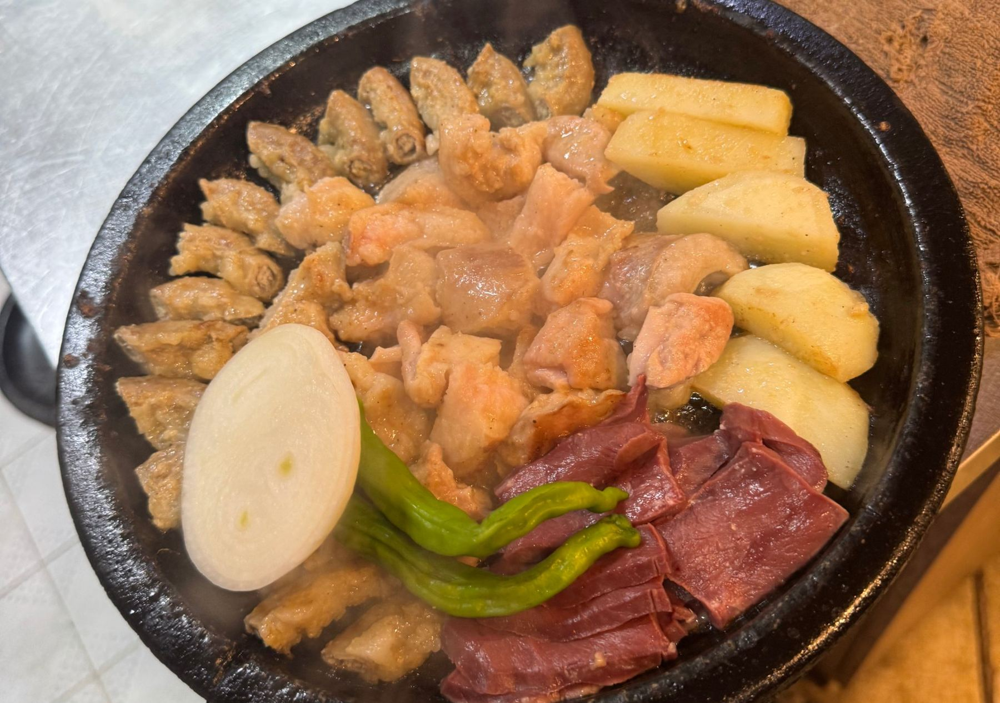
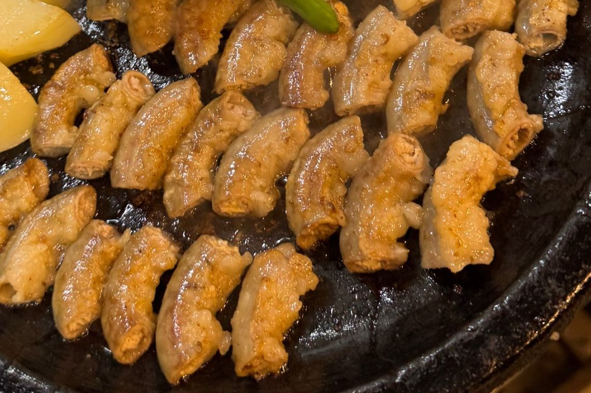
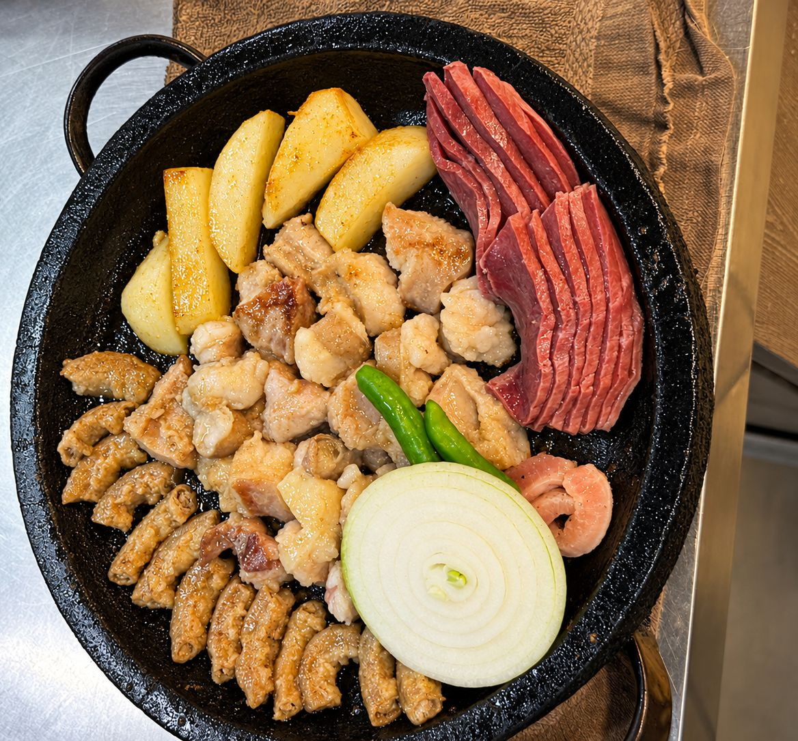
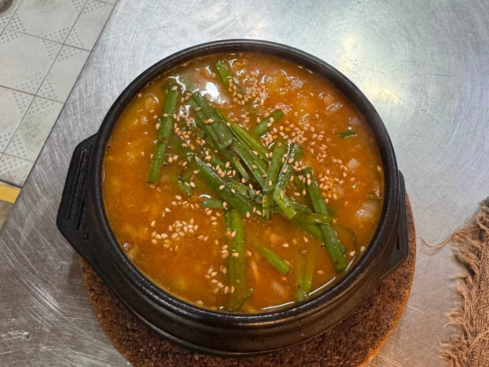
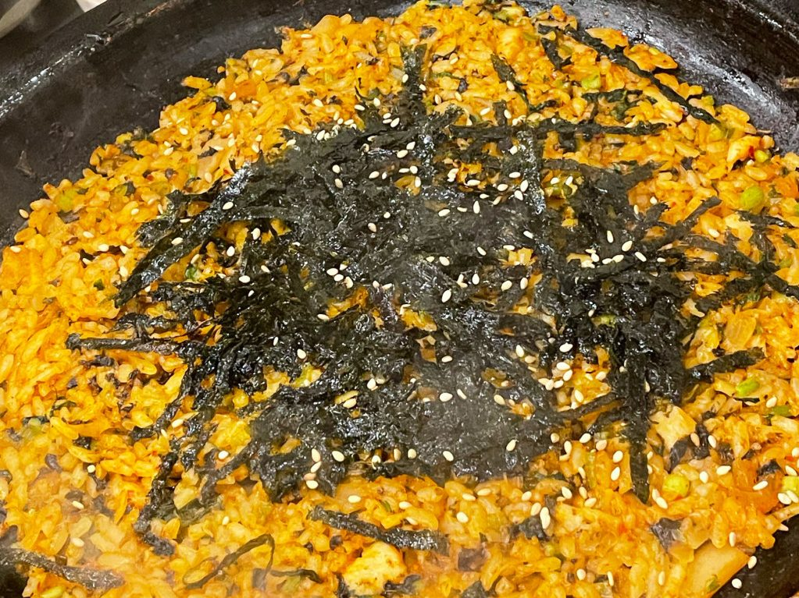
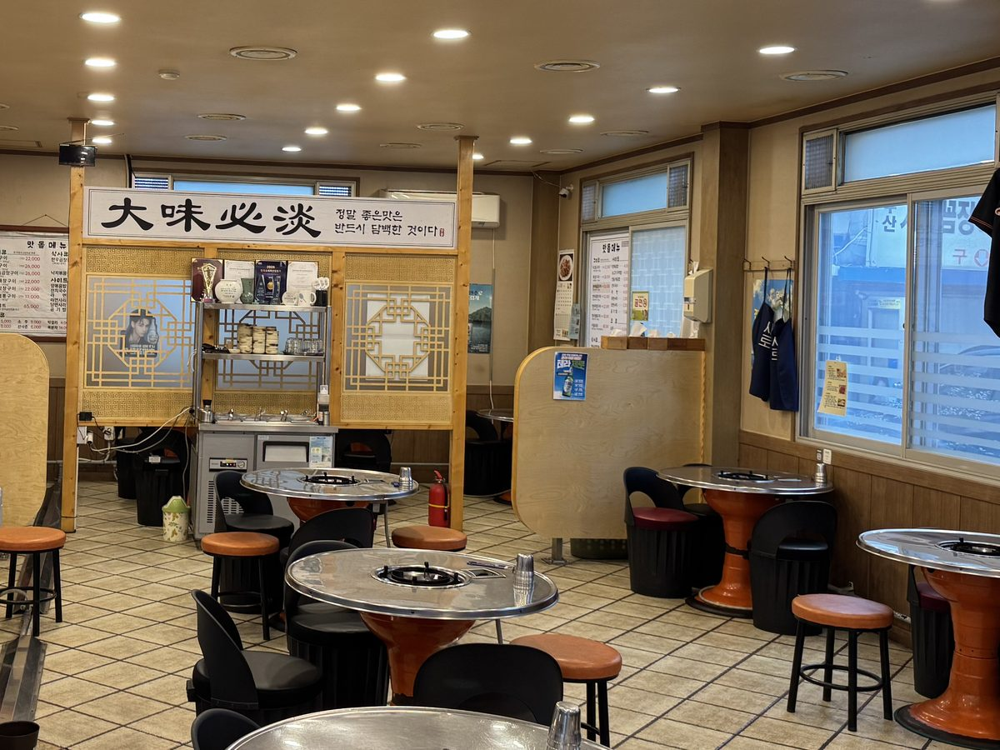
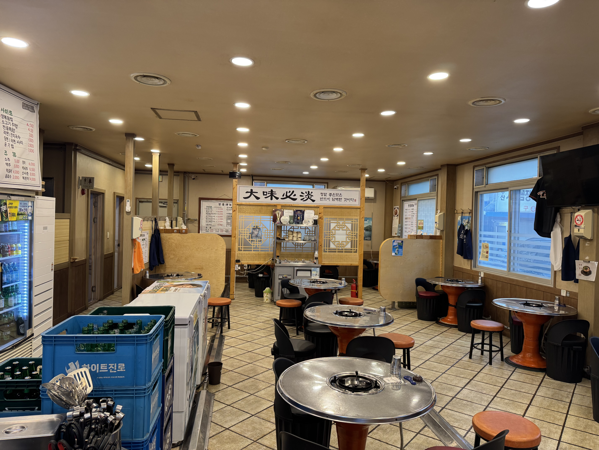
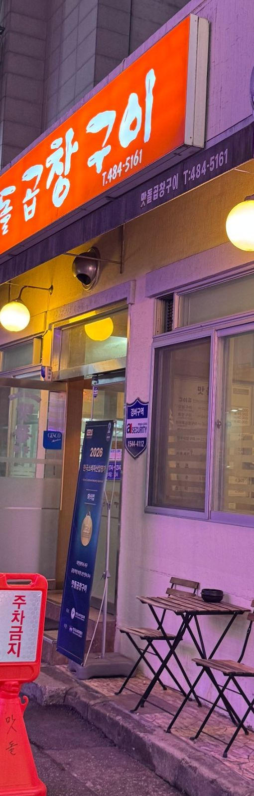

# 맛돌곱창구이 홈페이지

대전 서구 소곱창구이 전문점 맛돌곱창구이의 원페이지 홈페이지입니다.
주소: https://jinpark4525.github.io/matdol/

## 사진 바꾸는 법

사진은 모두 `img` 폴더에 있습니다. **새 사진의 파일 이름을 아래 표의 이름과 똑같이 바꿔서** `img` 폴더에 올리면, 홈페이지의 해당 자리 사진이 바뀝니다. index.html은 고칠 필요가 없습니다.

1. 바꿀 사진의 파일 이름을 표에서 찾아, 새 사진 파일 이름을 똑같이 바꿉니다. (예: `hero.jpg`)
2. 이 저장소에서 `img` 폴더를 엽니다.
3. 오른쪽 위 **Add file → Upload files**를 누르고, 새 사진을 끌어다 놓습니다.
4. 아래 **Commit changes**를 누릅니다. 같은 이름의 기존 사진이 새 사진으로 바뀝니다.
5. 1~2분 뒤 홈페이지를 새로고침하면 바뀐 사진이 보입니다. 휴대폰에서 그대로면 브라우저를 껐다 켜 보세요.

### 사진 자리

| 파일 이름 | 홈페이지 위치 | 지금 사진 | 권장 |
| --- | --- | --- | --- |
| `hero.jpg` | 맨 위 첫 화면 배경 |  | 가로 사진, 가로 1,800px. 가운데가 잘 보이게 (위아래가 조금 잘림) |
| `logo.png` | 첫 화면 로고, 맨 아래 |  | 배경이 투명한 흰 글씨 PNG. 간판 원본 파일이 생기면 교체 |
| `hyeonpan.jpg` | 25년 이야기 (大味必淡 현판) |  | 아주 긴 가로 사진. 비율 그대로 보임 |
| `gopchang.jpg` | 손질 원칙 옆 곱창 사진 |  | 가로 사진 (3:2로 잘림). 주방·손질 장면은 넣지 않기 |
| `modum.jpg` | 부위별 구이 옆 모듬구이 |  | 정사각형으로 잘림 |
| `jeongol.jpg` | 한우곱창전골 (크기별 가격 옆) |  | 가로 사진 (4:3으로 잘림) |
| `sulbap.jpg` | 마무리와 후식: 맛돌술밥 카드 |  | 가로 사진 (4:3으로 잘림) |
| `yangbap.jpg` | 마무리와 후식: 양볶음밥 카드 |  | 가로 사진 (4:3으로 잘림) |
| `interior.jpg` | 단체석과 상차림 (왼쪽, 1층 매장 내부) |  | 가로 사진 (4:3으로 잘림). 맥주 상자·냉장고·광고물이 안 나오게 |
| `banchan.jpg` | 단체석과 상차림 (오른쪽, 기본 상차림) |  | 가로 사진 (4:3으로 잘림) |
| `award.jpg` | 수상 섹션 (상패·인증서) |  | 가로 사진. 비율 그대로 보임 |
| `exterior.jpg` | 찾아오는 길 (1층 외관) |  | 가로 사진 (5:4로 잘림). 간판과 입구가 함께 보이게. 차량 번호판·사람 얼굴이 안 나오게 |

### 사진 올릴 때 지킬 것

- **파일 이름은 영문 소문자 그대로**: `Hero.JPG`, `hero.jpeg`처럼 대문자나 다른 확장자면 홈페이지에 반영되지 않습니다. 반드시 `hero.jpg`처럼 표와 똑같이 맞춥니다.
- **확장자 두 번 주의**: Windows에서 확장자가 숨겨진 상태로 이름을 바꾸면 `hero.jpg.jpg`처럼 됩니다. 파일 탐색기의 **보기 → 표시 → 파일 확장명**을 켜고 이름을 바꾸세요.
- **용량은 1MB 이하 권장**: 휴대폰 원본(3~8MB)을 그대로 올려도 보이지만, 홈페이지가 느리게 열립니다. 카카오톡으로 보낸 사진을 저장하면 보통 1MB 안팎으로 줄어듭니다.
- **실제 사진만**: AI 생성 사진이나 실물과 다르게 보정한 사진은 쓰지 않습니다. 가족 얼굴, 손질 과정, 주류 광고, 손님 얼굴은 넣지 않습니다.
- **잘못 올렸을 때**: 이 저장소의 커밋 기록(History)에서 이전 사진으로 되돌릴 수 있습니다.

## 글 고치는 곳 (index.html)

- 전화번호: `042-484-5161`, `tel:0424845161`을 모두 찾아 바꾸기
- 스마트스토어 버튼: `스마트스토어 주소가 나오면` 주석 아래 줄의 주석을 풀고 주소 넣기
- 리뷰 수·평점: `995`, `4.67`, 기준 날짜 문구

## 파일

- `index.html`: 홈페이지 본문
- `img/`: 사진과 로고
- `.nojekyll`: GitHub Pages가 파일을 그대로 보여 주게 하는 빈 파일 (지우지 마세요)
